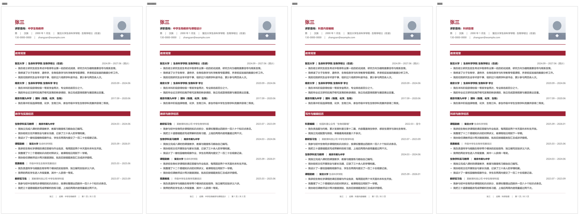

# resume-cn

中文简历的写作工具。一份个人信息，按岗位改成几版简历；页数、分区、语言、字体四类问题由程序检查。

 


## 目录

- [为什么做这个工具](#为什么做这个工具)
- [快速开始](#快速开始)
- [三层结构](#三层结构)
- [检查项](#检查项)
- [排版](#排版)
- [字体](#字体)
- [转 PDF](#转-pdf)
- [做不到的事](#做不到的事)
- [参考](#参考)
- [许可](#许可)

## 为什么做这个工具

我投过学校、教育机构和企业三类岗位，每投一处改一版简历。改得多了，出错的总是同样的四处。

一是页数。加一条经历，两页变成三页，生成前看不出来。
二是机构名。为上一家单位写的句子没删，投给了下一家。
三是文件名。公告要求写成“学科+姓名+学历+毕业院校”，每次都要翻回去找。
四是字体。换一台机器转 PDF，字体没装，字距和行距都变，页数跟着变。

这四处我都遇到过。工具把它们做成检查项，生成时一并运行，哪一条没过就报出来。

## 快速开始

```bash
git clone https://github.com/Golden2002/resume-cn.git
cd resume-cn
npm install

node src/cli.js new my-resume
node src/cli.js check --data my-resume --variant teacher-biology
```

第二条命令会渲染一份简历，然后跑完所有检查。全部通过时输出如下：

```
✓ schema 校验通过
✓ DOCX  .../李天行-teacher-biology.docx （104 KB，143 ms）
✓ PDF   .../李天行-teacher-biology.pdf
✓ 体例门禁（3 页，判据：PyMuPDF）
✓ 语言门禁（17 条规则，0 违例）
✓ 字体嵌入（8 个字体描述符，都带嵌入流）
✓ 声明字体（PDF 内匹配到 微软雅黑）
✓ ATS 往返（单源校验：pymupdf）
✓ 隐私门禁（仓库内未发现完整身份证号）

全部通过
```

检查不通过时退出码是 1，可以直接挂到 CI 上。

## 三层结构

个人信息、版式、岗位取舍分开放。改岗位时只动最后一层。

```
data/        私有，已在 gitignore 里。个人信息与岗位变体
templates/   公开。版式：颜色、字号、行距、页边距
src/         公开。渲染与检查
skills/      公开。中文写作规范，可以单独拿去用
```

同一份信息，四个岗位版本：



差别在取舍与先后：双语版把双语课程挪到第三位，把考研辅导放到最后；初中版删掉考研辅导与论文，荣誉只留四条。

岗位变体写成一份配置：

```yaml
template: fudan-red
label: 初中生物教师
pageBudget: 2
photo: true

content:
  - section: education
    title: 教育背景
  - section: work
    title: 教学与实践经历
    ids: [w-competition, w-bilingual, w-igem, w-ta]
    bullets: 2
  - section: awards
    title: 荣誉与资质

forbidEntities:
  - 某民办中学
```

## 检查项

### 体例

| 编号 | 检查 | 依据 |
|---|---|---|
| L1 L2 | 页数与预算比 | PDF 实际页数，优先用 PyMuPDF |
| L3 | 变体声明的分区是否齐全 | 分区标题要出现在正文里 |
| L4 | 个人陈述是否在最后 | 陈述之后不得再有其他分区 |
| L5 | 陈述长度 | 不超过设定的字数，默认 300 字 |
| L6 | 是否出现禁用的机构名 | 逐条比对 |
| L7 | 是否含身份证号 | GB 11643 的校验位加出生日期判断 |

### 语言

17 条规则，每条带条款号。

| 依据 | 内容 |
|---|---|
| GB/T 15834—2011 | 中文句内的全角标点、破折号、引号的写法 |
| GB/T 15835—2011 | 数字与量词之间的空格 |
| W3C《中文排版需求》 | 中文与西文之间的空格 |
| 余光中《中文的常态与变态》 | 拆散单音节动词、虚指主语、赘余的最高级说法 |
| 语域 | 正式文本不用口语词 |
| 去 AI 腔 | 空心评价、连接词起句、钩子句、情绪自白、伪发现、叙事铺垫 |

规则集在 [skills/chinese-writing](skills/chinese-writing/SKILL.md)，一份文件，不依赖本项目代码。

### 产物

| 检查 | 依据 | 不通过时 |
|---|---|---|
| 字体是否嵌入 | 每个字体描述符都要带嵌入流 | 报出描述符数与嵌入流数 |
| 声明的字体是否真的用上 | PDF 的 BaseFont 里要有这个字体族 | 列出 PDF 里实际用的字体 |
| 机器能否读出正文 | 两个以上抽取器交叉比对；只有一个时退化为单源校验 | 一个都没有时跳过，并说明装哪几个 |
| 仓库是否含隐私 | 扫全仓库，找校验位成立的身份证号 | 指出文件 |

## 排版

下面这些数值来自定稿的生成脚本，我逐项抄到模板里。

| 层级 | 元素 | 字号 | 字重 |
|---|---|---|---|
| 焦点 | 姓名 | 20 pt | 加粗 |
| 引导 | 求职意向、分区标题 | 11 pt | 加粗 |
| 信息 | 条目主行、正文 | 10 pt | 主行加粗 |
| 辅助 | 日期、单位、联系方式 | 9.5 pt | 常规 |
| 页脚 | 页码 | 8 pt | 常规 |

字号只分这五档，档位再多，读者反而分不出主次。

页边距上下 41 pt、左右 54 pt。分区标题条高 20.4 pt，白字前面垫一个空格当左边距；条高靠最小行高写死，因为 LibreOffice 对单行段落按字号给最小行高，调行距倍数不起作用。

加粗只用在三处：姓名、分区标题、条目的主标题。灰色单位名里需要点出机构时，在数据里用双星号标出，加粗的同时改用正文色：

```yaml
name: "**山东省烟台第一中学** · 生物竞赛暑期培训"
```

日期、联系方式、正文一律不加粗。一条经历里最多两处加粗，多了等于没有强调。

## 字体

仓库里不放字体文件。模板默认写微软雅黑，也就是我自己在做的那一款。别人机器上没有雅黑时，有两条路：

```bash
# 装思源黑体（SIL OFL 1.1），装进当前用户的字体目录
node src/cli.js fonts install --to-user
node src/cli.js check --data my-resume --variant teacher-biology --font "Source Han Sans SC"

# 或用手上任意一款
node src/cli.js fonts define --family "我的字体" --regular D:\fonts\r.ttf
node src/cli.js check --data my-resume --variant teacher-biology --font "我的字体"
```

行高在 `lineHeightPt` 里写成固定值，所以换字体不影响版面。把微软雅黑换成思源黑体，两页仍是两页。

检查程序会比对 PDF 里的字体名，确认声明的字体真的用上了。PDF 里只记拉丁名，微软雅黑在里头叫 `MicrosoftYaHei`，所以项目里带一张对照表，覆盖雅黑、思源、Noto、宋体、黑体、楷体、仿宋、苹方。

## 转 PDF

DOCX 出来后要转成 PDF。两条路：

```bash
# LibreOffice。装好之后 soffice 在 PATH 里就能用
node src/cli.js check --data my-resume --variant teacher-biology --pdf-engine libreoffice

# Microsoft Word。基准简历是 Word 2019 导出的，要跟它逐页对齐就用这条
node src/cli.js check --data my-resume --variant teacher-biology --pdf-engine word
```

Word 那条路通过 COM 调 `tools/convert-word.ps1`，只在 Windows 上可用。我还在本机试过把 LibreOffice 与 Word 的输出并排比对，两边的页数与分区位置能对上，但底色条有一处差异：

Word 铺段落底色时不理会左右缩进，LibreOffice 会按缩进把底色一起收窄。所以同一个缩进值，Word 出满栏的条，LibreOffice 出的条会窄两三毫米。模板把缩进设成 0、另用一个空格做左边距，两边就一致了。

## 做不到的事

- 检查判合规，不判好看。版面顺不顺眼还得人看。
- 机器能读出正文，不等于招聘方会给面试。
- 正文抽取的质量取决于装了哪几个抽取器。只有一个时是单源校验，报告里会写明。
- 分页以选定的引擎为准。同一份 DOCX，Word 与 LibreOffice 可能分到不同页。
- 身份证校验位只判格式，不保证号码真的存在。

## 参考

- [RenderCV](https://github.com/rendercv/rendercv)：内容写在 YAML 里，版式交给模板。这个分法我照搬了。
- [JSON Resume](https://jsonresume.org)：字段名沿用它，中文场景的字段放在 `cn` 下面。
- [paeg-teaching-language-skill](https://github.com/Golden2002/paeg-teaching-language-skill)：中文写作规范的来源，`skills/chinese-writing/` 里的标点、数字两节由它整理而来。

## 许可

代码用 MIT。

字体不随仓库分发。`fonts install` 从 Adobe 官方仓库下载思源黑体（SIL OFL 1.1），打印 SHA256，装到当前用户的字体目录。本机常用的商业字体请在自己的授权范围内使用，不要提交进公开仓库。
