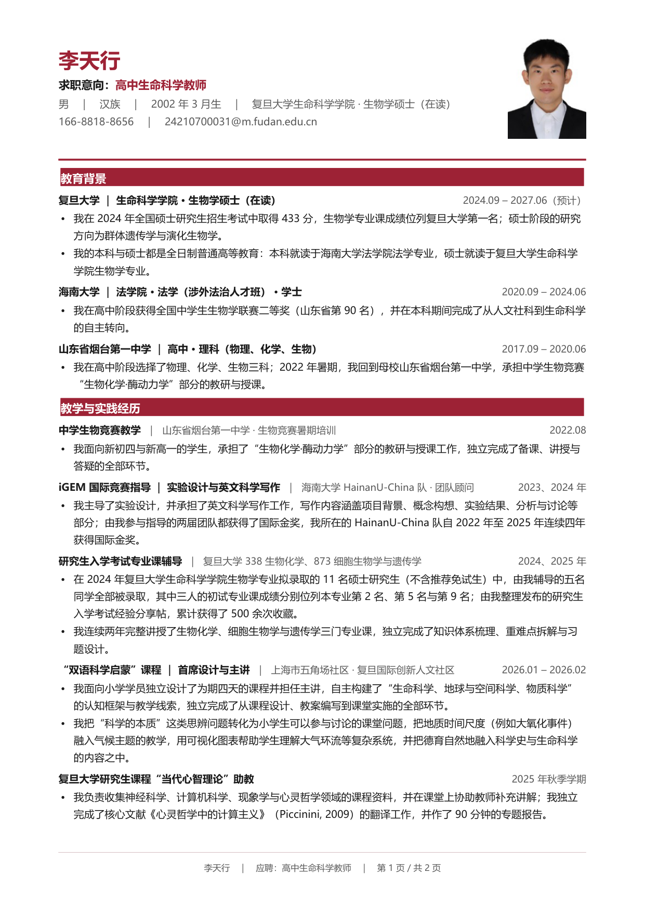

# resume-cn

**中文简历的文档工程。** 用一份事实数据，生成面向不同岗位、版面稳定的中文简历，并把体例、语言、产物三类检查做成机器判定。

  



---

## 目录

- [它解决什么问题](#它解决什么问题)
- [30 秒上手](#30-秒上手)
- [四层分离](#四层分离)
- [三道门禁](#三道门禁)
- [怎样设置字体](#怎样设置字体)
- [数据格式](#数据格式)
- [岗位变体](#岗位变体)
- [命令行](#命令行)
- [模板](#模板)
- [已知局限](#已知局限)
- [路线](#路线)
- [中文写作规则](#中文写作规则)
- [开发与贡献](#开发与贡献)
- [许可](#许可)

---

## 它解决什么问题

生成简历的工具很多。[RenderCV](https://github.com/rendercv/rendercv) 用 YAML 转 Typst 出 PDF，[JSON Resume](https://jsonresume.org/media) 从 2014 年起维护开放 schema，两者都成熟。这个项目不做生成器，做的是它们不做的那一段：**让中文简历能被判定对错**。

中文简历有几类错，人工做十份会犯一次，犯了还看不出来：

| 失效模式 | 后果 | 本项目的对策 |
|---|---|---|
| 加分项一加，两页变三页 | 版面承诺破了，投递前才发现 | 页数预算写进变体，超出即报错并提示压哪一条 |
| 上一版为某校定制的句子投给另一校 | 一眼看出是套模板 | `forbidEntities` 声明禁用机构名，命中即失败 |
| 转换 PDF 的机器没装模板字体 | 字体被静默替换，字面宽度与版式全变 | 比对 PDF 的 `BaseFont`，不是只看有没有嵌入 |
| 文件名要“学科+姓名+学历+毕业院校” | 没按规定命名，直接被筛 | 文件名由变体与公告要求决定，人工不用记 |
| 中文 Windows 上 Python 输出走 GBK | 文本抽取中途崩溃，ATS 检查形同虚设 | 抽取器统一强制 UTF-8，并报告用了几路 |
| 把真实身份证号写进公开仓库 | 无法撤回 | 隐私门禁按 GB 11643 校验位判定，CI 拦截 |

---

## 30 秒上手

```bash
git clone <repo-url> && cd resume-cn
npm install

node src/cli.js new my-resume                     # 用示例数据建目录
node src/cli.js check --data my-resume --variant teacher-biology
```

`check` 一条命令完成渲染与三道门禁。全部通过时输出如下：

```
✓ schema 校验通过
✓ DOCX  .../李天行-teacher-biology.docx （104 KB，143 ms）
✓ PDF   .../李天行-teacher-biology.pdf
✓ 体例门禁（2 页，判据：PyMuPDF）
✓ 语言门禁（17 条规则，0 违例）
✓ 字体嵌入（8 个字体描述符，均带嵌入流）
✓ 声明字体（PDF 内匹配到 微软雅黑）
✓ ATS 往返（单源校验：pymupdf）
✓ 隐私门禁（仓库内未发现完整身份证号）

全部通过
```

门禁失败时退出码为 1，可直接挂 CI。

**PDF 转换**依赖 LibreOffice。按下列顺序自动探测：`--pdf-cmd`、环境变量 `RESUME_CN_PDF_CMD`、PATH 里的 `soffice` 或 `libreoffice`、环境变量 `RESUME_CN_KIT_NODE` 与 `RESUME_CN_KIT_CLI` 指定的便携版。都没有时只出 DOCX，并如实报告。

---

## 四层分离

数据、模板、内容选用、渲染流程互不认识。这一条是整个项目的骨架。

```
data/          私有，已 gitignore。事实字段（每条可追到证书扫描件）与岗位变体
templates/     公开。复旦红模板：颜色、字号、行距、页边距全在 template.yaml 里
src/           公开。渲染、门禁、命令行
skills/        公开。可独立拿用的中文写作规则集
docs/          公开。决策记录与截图
```

同一份数据，四个岗位变体：


差别不在措辞，在取舍与顺序：双语版把双语课程提到第三位、把考研辅导后置；初中精简版砍掉考研辅导与论文作品，荣誉只留四条。

---

## 三道门禁

### 体例门禁

| 编号 | 检查 | 判据 |
|---|---|---|
| L1 L2 | 页数与预算 | PDF 实际页数，优先用 PyMuPDF，退化到结构计数 |
| L3 | 分区齐全 | 变体声明的每个分区标题都要出现在正文 |
| L4 | 陈述位置 | 个人陈述之后不得再有其他分区 |
| L5 | 陈述长度 | 不超过 `maxChars`，默认 300 字 |
| L6 | 机构名越界 | `forbidEntities` 里的名字不得出现在正文 |
| L7 | 身份证号 | GB 11643 加权模 11 校验位加出生日期合理性 |

### 语言门禁

17 条规则，每条挂条款号，不写“我们觉得”。

| 依据 | 覆盖 |
|---|---|
| GB/T 15834—2011 | 中文句内全角标点、破折号不加空格、引号用弯引号 |
| GB/T 15835—2011 | 数字与量词之间加半角空格 |
| W3C《中文排版需求》clreq | 中西文之间的半角空格 |
| 余光中《中文的常态与变态》 | 拆散单音节动词、虚指主语、赘余的最高级套语、单字成词 |
| 去 AI 腔清单 | 空洞评价、连接词起句、钩子句、第一人称情绪、伪发现、叙事铺垫 |

规则集可独立取用，见 [skills/chinese-writing](skills/chinese-writing/SKILL.md)。

### 产物门禁

| 检查 | 判据 | 做不到时 |
|---|---|---|
| 字体嵌入 | PDF 里每个 `FontDescriptor` 都要有字体流 | 失败，报告描述符数与嵌入流数 |
| 声明字体是否真被用上 | PDF 的 `BaseFont` 要出现模板声明的字体族 | 失败，列出 PDF 内实际字体 |
| ATS 往返 | 两个以上抽取器交叉比对；只有一个时退化为单源校验并标注 | 一个都没有时跳过并说明装什么 |
| 隐私 | 全仓库扫描校验位成立的身份证号 | 失败，指出文件 |

---

## 怎样设置字体

**仓库不分发任何字体二进制**，只写字体名。模板默认微软雅黑，也就是本项目日常在用的那款。换字体有三条路：

```bash
# 一、系统里已有，直接用（默认就是这条路）
node src/cli.js fonts status --family 微软雅黑

# 二、没有微软雅黑：下载思源黑体（SIL OFL 1.1）并装进用户字体目录
node src/cli.js fonts install --to-user
node src/cli.js check --data my-resume --variant teacher-biology --font "Source Han Sans SC"

# 三、用自己手上的任意一款字体
node src/cli.js fonts define --family "我的字体" --regular D:\fonts\r.ttf --bold D:\fonts\b.ttf
node src/cli.js check --data my-resume --variant teacher-biology --font "我的字体"
```

**换字体不改版式。** 行高写在 `template.yaml` 的 `lineHeightPt` 里，是显式值，不随字体度量浮动。实测微软雅黑换思源黑体（后者默认行高约高 9%），两页仍是两页，纵向坐标差 7 pt 以内。

**门禁会验字体是否真被用上。** PDF 的 `BaseFont` 只写拉丁名，微软雅黑在其中是 `MicrosoftYaHei`。项目内置族名别名表，覆盖雅黑、思源、Noto、宋体、黑体、楷体、仿宋、苹方，不会因为中文族名匹配不上拉丁名而误判。

---

## 数据格式

字段命名以 JSON Resume 为基线，`cn` 命名空间下放中文场景的扩展。

```yaml
basics:
  name: 张三
  label: 中学生物教师
  phone: "130-0000-0000"
  image: photo.jpg
  cn:
    gender: 男
    birthDate: "2000-01"                       # 渲染为“2000 年 1 月生”
    headline: 某大学生命科学学院 · 生物学硕士（在读）
education:
  - institution: 复旦大学
    area: 生命科学学院
    studyType: 生物学硕士（在读）
    startDate: "2024.09"
    endDate: "2027.06（预计）"
    highlights:
      - 我在 2024 年全国硕士研究生招生考试中取得 433 分，生物学专业课成绩位列复旦大学第一名。
```

> **日期与编号一律加引号。** YAML 会把 `2024.09` 解析成数字，18 位证书编号还会丢精度。工具做兜底转换并提示，丢精度的直接报错。

`evidence` 段记录字段溯源，不写入正文：

```yaml
evidence:
  certificates[0].credentialId:
    file: evidence/教师资格证.pdf
    note: 与证书原件逐字核对
    checkedAt: "2026-11-22"
```

本 schema 不接收身份证号。需要证明身份时，用 `evidence` 指向扫描件。

---

## 岗位变体

内容选用写在这一层。不写进数据，也不写进模板。

```yaml
template: fudan-red
label: 初中生物教师
pageBudget: 2
photo: true

content:
  - section: education
    title: 教育背景
  - section: work
    title: 教学与实践经历
    ids: [w-competition, w-bilingual, w-igem, w-ta]   # 按这个次序排，缺省按数据原序
    bullets: 2                                        # 每条最多取 2 条 highlights
  - section: awards
    title: 荣誉与资质
    ids: [a-qual, a-subject, a-igem]
  - section: skills
    title: 语言与技能

forbidEntities:
  - 某民办中学          # 简历里不该出现应聘单位的名字
```

**个人陈述默认关闭。** 中文简历不需要开场自述，占版面且冲淡证据。只有招聘公告明确要求时才启用 `statement`，且渲染器强制把它放在最后，有门禁专查位置与字数。

---

## 命令行

| 命令 | 作用 |
|---|---|
| `new <目录>` | 用示例数据建一个数据目录 |
| `build --data <目录> --variant <名>` | 渲染 DOCX 与 PDF |
| `check --data <目录> --variant <名>` | 渲染并执行三道门禁 |
| `fonts status --family <族名>` | 报告字体是否已装，给出安装指引 |
| `fonts install --to-user` | 下载思源黑体并装进用户字体目录 |
| `fonts define --family <族名> --regular <文件>` | 登记自有字体 |

通用参数：`--font <族名>` 覆盖模板字体，`--no-pdf` 只出 DOCX，`--pdf-cmd <命令>` 指定转换命令，`--out <目录>` 指定产物位置。

---

## 模板

`templates/fudan-red/template.yaml` 是渲染器唯一的输入。颜色、字号、行距、页边距、证件照尺寸、分区标题、单行分区的标签词都在里面，模板清单里没有代码。

换模板就是换一份清单加一个布局实现。几条硬约束：

- 行高必须写显式值。docx 的自动行高随字体度量变化，换个字体两页会被顶成三页。
- 分区标题条要带 `keepNext`，否则标题会孤零零留在页底。
- 首页表格必须显式给出 `columnWidths`，缺省会让左栏按内容自适应，正文折行。
- 证件照尺寸以像素计（96 dpi），96×128 px 约合两寸。
- 任何字体二进制都不要入库。

---

## 已知局限

- **门禁判合规，不判好看。** 版面美观仍需人看。
- **ATS 往返只能证明机器读得对**，不能证明招聘方会给面试。
- **正文抽取质量取决于装了哪几个抽取器。** 只有一路时是弱校验，报告里会标注。
- **分页以 LibreOffice 为准。** 同一份 DOCX 用 Word 打开，分页可能不同。
- **身份证校验位只做格式判断**，不保证号码真实存在。

---

## 路线

- **M1 能复现**：与既有来源逐页对齐，产物稳定。已完成。
- **M2 陌生人可用**：一个没读过代码的人，只读本 README，十分钟内产出 PDF。
- **M3 可发布**：CI 双平台、模板预览图自动生成、veraPDF 与多解析器报告随 release 附上。

公开承诺记在 [docs/DECISIONS.md](docs/DECISIONS.md)：M1 结束时复判一次，是否该改为给 RenderCV 写中文主题。判据是三条，被覆盖两条就停止自建。

---

## 中文写作规则

门禁用的那套规则可以单独拿走用，见 [skills/chinese-writing](skills/chinese-writing/SKILL.md)。它是一份给模型读的技能文件，含规则表、正例反例与审校流程，不依赖本项目代码。

<!-- audit:ignore-start -->

规则表本身要写出被禁的词，否则说不清楚。这一段豁免文档语言审计：

| 类别 | 不要写 | 改成 |
|---|---|---|
| 拆散动词 | 进行、作出、予以 | 直接用单音节动词 |
| 虚指主语 | 人们 | 大家，或删掉主语 |
| 赘余 | ……之一 | 直接说 |
| 单字成词 | 均、另 | 都、其他 |
| 空心评价 | 至关重要、发挥着作用 | 写具体后果 |

<!-- audit:ignore-end -->

---

## 开发与贡献

```bash
npm run test          # 门禁与字体单元测试，共 22 项
node tools/audit-docs.js   # 文档语言审计，要求 0 违例
```

文档与产物走同一套语言规则。改 README 或 docs 之后运行一次审计，别让说明自己违规。

新增模板请附一张渲染截图，并在 `template.yaml` 里声明页数预算与字体。新增门禁请挂条款依据，写明判据与失败时的处置方式。

---

## 许可

代码 MIT。

字体：仓库不含任何字体文件，`fonts/` 已排除。默认字体写在模板清单里，只是一个字体名。`fonts install` 从 Adobe 官方仓库下载思源黑体（SIL OFL 1.1）并打印 SHA256，装到用户字体目录，文件不随仓库分发。本机常用的商业字体请在自有授权范围内使用，不要提交进任何公开仓库。
